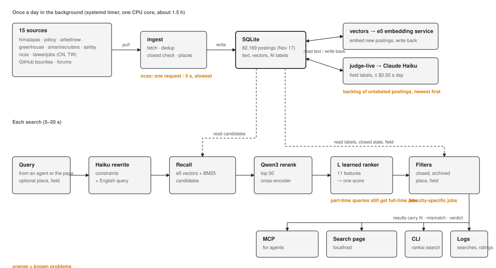
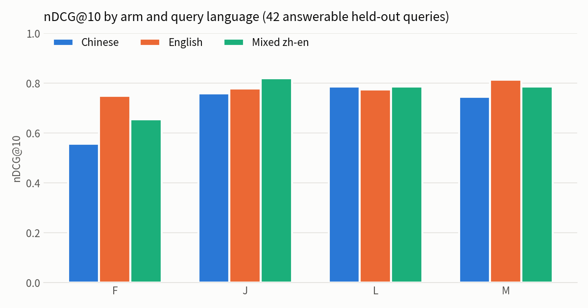

# rankai: a bilingual job and collaboration search engine with pre-registered evaluations

rankai ingests job, gig, bounty and co-founder postings from 15 public sources (official APIs, RSS feeds and public
ATS endpoints), deduplicates them, ranks them with BM25 + e5 retrieval, a cross-encoder reranker and a learned ranker,
and serves the result to AI agents over MCP. Every ranking change was tested on new held-out queries with a written
analysis plan.

Design: [docs/DESIGN.md](docs/DESIGN.md) · Evaluation: [docs/EVALUATION.md](docs/EVALUATION.md) ·
Sources and terms: [docs/SOURCES.md](docs/SOURCES.md) · MCP: [docs/MCP.md](docs/MCP.md) ·
Data: [docs/DATA.md](docs/DATA.md) · [中文简介](README.zh-CN.md)

## Problem

Someone looking for "a remote part-time RAG engineer role, at least $60/h" or "杭州 线下 前端开发 全职" has to search
many boards that each cover one slice: company career pages, remote-job boards, government job services, forums
and GitHub bounties. Many postings are duplicates, many are closed, and Chinese queries match almost nothing in a
mostly English corpus. Rankings tuned by hand are hard to trust: a weight that looks sensible can quietly make results
worse.

This project asks:
- Can one local index over many public sources answer such queries, in Chinese, English or both mixed?
- Which parts of a modern ranking stack (hybrid retrieval, reranking, LLM query rewriting, LLM judgments of postings,
  hand-set priors, learned weights) actually help? The test is new queries written by models that never saw the
  corpus or the ranker.
- Where results are poor, is the cause the ranking or the corpus?

## Architecture



| Stage | What it does | Code |
|---|---|---|
| Ingest | 15 fetchers. Each keeps its source's documented limits (e.g. Remotive at most 4 calls a day, Jobicy one pass an hour, ncss one request every 5 s). Raw payloads are append-only; postings are normalized: kind, remote, pay, place, language. Contact details from government sources are redacted at fetch time | `rankai/sources.py`, `rankai/ingest.py`, `rankai/text.py` |
| Dedup | Same normalized (company, title) = one cluster; search shows each job once | `rankai/ingest.py: cluster` |
| Freshness | Greenhouse / Ashby / Lever return a company's full listing, so a posting missing from the latest successful fetch is closed and hidden. Jobs older than 30 days are archived (searchable on request) | `rankai/fresh.py` |
| Places | Every posting is classified into place paths (`China/Zhejiang/Hangzhou`, `*` = anywhere) for `where=` filtering | `rankai/places.py`, `rankai/regions.py` |
| Recall | BM25 (SQLite FTS5; Chinese as character bigrams, traditional folded to simplified) + multilingual-e5-small vectors, fused with RRF. Claude Haiku rewrites the query into English search terms plus constraints | `rankai/search.py`, `rankai/qrewrite.py` |
| Rerank | Qwen3-Reranker-0.6B scores the top 50 candidates against the original query and the English rewrite | `rankai/models.py` |
| Learned ranker (L, default) | Gradient boosting over 11 features (two reranker scores, two vector similarities, constraint violations, freshness, source type, completeness, scam rule, forum, Chinese text). Trained on 4,507 labeled pairs from 144 queries | `rankai/search.py`, `eval/ltr.py` |
| Output | Each result has a `fit` band (strong / possible / weak), `mismatch` tags (e.g. `fulltime, not parttime`, `in Guangzhou, not Hangzhou`), and the search has a `verdict` on whether the corpus likely holds a good match | `rankai/mcp_server.py` |
| Interfaces | MCP server (stdio), CLI, local search page | `rankai/mcp_server.py`, `rankai/__main__.py`, `rankai/web.py` |

The corpus held **82,169 postings from 15 sources** on 2026-11-17 (63,261 English, 18,908 Chinese). 7,298 duplicate
clusters cover 21,858 of them. The default search hides closed and archived jobs.

## Results

All labels are graded 0–3 by two LLM labelers from different vendors (composer-2.5 and grok-4.7). A model that wrote a
query set never labels it. Final grade = mean. Metric: nDCG@10 (gain 2^rel − 1) over queries with at least one
relevant pooled posting; "good result" = grade ≥ 2. Tests: paired sign-flip randomization over queries (20,000
rounds); exact McNemar for coverage; Holm correction across the primary tests of a round.

### Confirmation round v3: 48 new queries written by GPT, plan fixed before the queries existed

| Arm | What it is | nDCG@10 | Chinese | English | Mixed |
|---|---|---|---|---|---|
| F | BM25 + e5 + RRF, Qwen3 rerank, Haiku query rewrite, hand-set penalties and priors | 0.654 | 0.557 | 0.749 | 0.655 |
| **J** | F's top-50 candidates ordered by the reranker score alone | **0.785** | 0.758 | 0.778 | 0.820 |
| L (default) | F's top-50 candidates, learned gradient-boosting ranker | 0.782 | 0.786 | 0.774 | 0.787 |
| M | J × (1 − 0.5 × violated constraints) | 0.782 | 0.746 | 0.814 | 0.787 |



| Primary test (pre-registered) | Difference | Wins / ties / losses | p | Holm-adjusted p |
|---|---|---|---|---|
| J vs F | **+0.132** | 29 / 0 / 13 | 0.0003 | **0.0009** |
| J vs M | +0.003 | 14 / 15 / 13 | 0.85 | 1.00 |
| Extra city-level ncss postings, coverage (42 queries) | 15 → 15 | +0 / −0 | 1.00 | 1.00 |

L vs J was a secondary test: −0.003, p = 0.90, a tie. L became the default as a product decision, because it can keep
improving as labels accumulate. On these queries it matched J, and it did not beat J.

### How the stack got there: four rounds of new queries

| Round | Queries | Finding | Evidence |
|---|---|---|---|
| v0 | 48, written by the developer agent (in-sample) | BM25 0.423 → + reranker 0.501 → + LLM query rewrite **0.736**. The rewrite is the single biggest gain (+0.250, p < 0.0001); Chinese queries go from 0.37 to 0.80 | 7 arms, 1,311 labeled pairs |
| v1 | 48 new, written by grok-4.7 | Rewrite gain replicates (+0.299, p < 0.0001). Learned weights vs F: +0.043, p = 0.076, not significant (+0.051, p = 0.043 after a labeling-card fix) | 968 pairs |
| v2 | 48 new, written by GPT | Primary: learned weights vs F +0.012, p = 0.68, **not confirmed**. New sources raised coverage from 8 to 15 queries (p = 0.016). Reranker-only J beat F by +0.070 (p = 0.010, secondary) | 1,262 new labels |
| Ablation | v1 + v2 pools (exploratory) | Every hand-set term was neutral or harmful when added to the reranker score; all together −0.060 (p < 0.001). Fixed offsets swamp reranker scores near 0 | existing labels |
| v3 | 48 new, written by GPT | J beats F (Holm p = 0.0009); multiplicative penalty M ties J; learned L ties J | 811 new labels |

Negative results were kept: two primary tests failed (learned weights in v2; the city backfill in v3), and the
hand-weight analysis is labelled exploratory. Full tables, per-round limits and costs: [docs/EVALUATION.md](docs/EVALUATION.md).

### The real bottleneck is coverage, not ranking

On the v3 queries only **15 of 48** had any good posting in the pool, and F, J, L and M covered exactly the same 15.
All 15 were remote roles: remote full-time 11/12, remote part-time or internship 4/6. City-specific jobs, freelance
gigs, outsourcing buyers, bounties and co-founder searches went 0/30. The MCP server therefore returns a calibrated
`verdict`, and agents are told to say so when no good match exists:

| `verdict` (top result's L score) | v3 queries | queries with a good result |
|---|---|---|
| good match likely (≥ 2.0) | 12 | 12 |
| related results only (1.0–2.0) | 25 | 3 |
| nothing good (< 1.0) | 11 | 0 |

## How to run

Python 3.10+ on Linux. Three local or remote services are needed for live search: an e5 embedding endpoint, a
Qwen3-Reranker endpoint and an Anthropic API key for the Haiku query rewrite.

```bash
pip install -r requirements.txt
python -m pytest -q                      # offline unit tests

# reproduce the evaluation tables from the stored runs and labels (no database, no models, no network)
python eval/score.py v3
python eval/paired.py v3 M:J F:J J:L F:L
RANKAI_LABEL_SET=prepay python eval/paired.py v2 F:H F:J_pre_t2s   # v2 as first reported (docs/EVALUATION.md §8)
```

Live search needs your own corpus. The postings themselves are not distributed ([docs/DATA.md](docs/DATA.md)):

```bash
export RANKAI_E5_URL=http://127.0.0.1:8080/v1/embeddings   # multilingual-e5-small, OpenAI-style embeddings API
export RANKAI_RERANK_URL=http://127.0.0.1:8000             # Qwen3-Reranker-0.6B served by vLLM (/score)
mkdir -p ~/.config/rankai && printf 'ANTHROPIC_API_KEY=<your key>\n' > ~/.config/rankai/env && chmod 600 ~/.config/rankai/env

python -m rankai ingest                  # every default source; read docs/SOURCES.md first
python -m rankai vectors                 # embed new postings
python eval/ltr.py --fit v0 v1 v1b v2 v2o v1c v2c   # rebuild L from the shipped labels and feature files
python -m rankai search "remote part-time RAG engineer, at least 60 USD an hour"
python -m rankai search "前端开发" --where 杭州
python -m rankai.mcp_server              # MCP over stdio; registration in docs/MCP.md
```

`ops/` has systemd user-unit templates for a daily refresh and the local search page (`ops/install.sh`).

**Check each source's terms yourself before you fetch.** [docs/SOURCES.md](docs/SOURCES.md) records what each
source's terms, robots.txt and API docs said when they were read on 2026-10-29/30. Terms change, and that record is
not legal advice. ncss.cn has no published terms or API docs, so it is opt-in: it is fetched only when named
(`python -m rankai ingest ncss`).

## Limitations

- **All relevance labels are LLM labels.** Labeler agreement is moderate (weighted kappa 0.61–0.73 by round; exact
  agreement 60–67%), and no human audit has been done yet.
- **Test queries are synthetic.** Models wrote them under instructions that require every engagement type, so they
  over-represent non-software roles and type constraints compared with real traffic. v3's three language groups
  partly restate the same 16 needs; a by-theme test is reported alongside.
- **Small samples.** 42–48 queries per round cannot detect small differences. A tie means no evidence of a
  difference, not equality.
- **Pooled evaluation.** Arms share F's top-50 candidates, so a good posting beyond rank 50 is invisible to every
  arm.
- **Coverage.** Most good results are remote roles from a few boards. Local, non-tech and freelance needs are poorly
  served, and the outsourcing platforms that would serve them forbid automated access.
- **Rule-inferred fields.** Job type, remote flag and place come from rules. The type mismatch tag wrongly flags 17%
  of good results.
- **Not reproducible end to end from this repository.** Posting text is not redistributed, and the labels are keyed
  to database ids that a fresh ingest will not reproduce. Scores and tests can be recomputed exactly; new runs need a
  new labeled set.
- The local search page's UI is in Chinese.

## Repository layout

| Path | Contents |
|---|---|
| `rankai/` | ingest, normalization, search arms A–M, MCP server, CLI, search page |
| `eval/` | analysis plans (`PLAN_v*.md`), query sets and query-author instructions, saved runs, pooled labels, scoring and statistics scripts, result JSON |
| `tests/` | offline unit tests |
| `ops/` | systemd user-unit templates |
| `docs/` | design, evaluation, sources, MCP, data |

Built with AI coding agents; I designed the system and experiments, set the evaluation rules and reviewed every result.

## License

MIT, see [LICENSE](LICENSE). Third-party services, models and data sources are listed in
[THIRD_PARTY_NOTICES.md](THIRD_PARTY_NOTICES.md).
