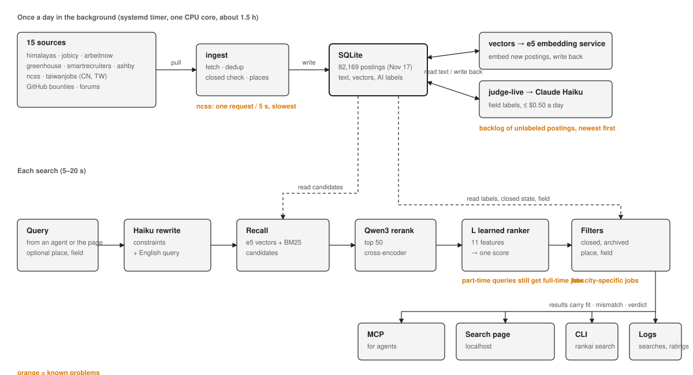

# Design

rankai started as a broader question: should AI judgments decide search rankings, and what would a careful engineer
do to find out? The answer the project took: pick one narrow domain where the builder is also a user, build the
evaluation first, then add AI layers one at a time. Each layer stays only if a controlled test on held-out queries
shows it helps. The first domain is **job, gig and collaboration opportunities**.

## 1. Principles

1. **Evaluation before features.** Every ranking change is compared with the current default on new queries that
   models wrote without seeing the corpus, the sources or any result. The analysis plan is written before runs or
   labels exist (`eval/PLAN_v*.md`).
2. **AI opinions are not facts.** LLM labels and judgments are recorded append-only with model, prompt version and
   cost. Labeling uses two labelers from different vendors. Whoever wrote a query set never labels it. The model that
   rewrites queries (Claude Haiku) is different from the labelers.
3. **"Ranking" is three different problems.** Relevance depends on the query (retrieval + reranking). Source quality
   is mostly query-independent (priors). Comparing entities on measurable attributes calls for extraction, not
   scoring. This project works on relevance and tests whether query-independent priors add anything (they did not).
4. **Learned weights over hand-set ones**, but only once labels show the learned version is at least as good.
5. **Public sources only, used within their terms** ([SOURCES.md](SOURCES.md)). Original links kept, attribution
   shown, no personal job-seeker posts, contact details redacted before anything leaves the machine.
6. **Report what the system cannot do.** Each search returns a calibrated verdict on whether the corpus is likely to
   hold a good match.

## 2. Domain

Searches are query-driven, e.g. "remote RAG part-time", "senior Rust backend, remote EU" or
"开源 LLM 推理项目找人合作" (looking for collaborators on an open-source LLM inference project). The system reads
no personal profile.

| `kind` | Meaning |
|---|---|
| `fulltime` | Full-time job |
| `parttime` | Part-time job |
| `contract` | Contract / freelance |
| `internship` | Internship |
| `outsourcing` | Outsourced project |
| `bounty` | Open-source bounty or paid issue |
| `cofounder` | Co-founder / partner search |

Kinds, remote flags, pay and places are inferred by rules (`rankai/text.py`, `rankai/places.py`). Where a source
states a job type, that statement wins. Otherwise the rules guess, and they are sometimes wrong (see
[EVALUATION.md](EVALUATION.md#mismatch-tags)).

### Ranking dimensions considered

| Dimension | Query-dependent | Implementation | Outcome |
|---|---|---|---|
| Match (role, skills, seniority) | yes | Qwen3-Reranker-0.6B cross-encoder on the original query and on the English rewrite | Core signal; L is mostly the two reranker scores |
| Hard constraints (remote / place, kind, minimum pay) | yes | Rules parse the query; Haiku's rewrite adds constraints; rules read posting fields | Fixed penalties hurt (ablation). Now shown as `mismatch` tags and used as one model feature (`viol`) |
| Freshness / still open | no | Time decay; closed-posting detection for full-listing ATS sources; 30-day archive | Freshness as a hand-set bonus hurt. As a feature it has near-zero weight. Closed/archived filtering stays as product behavior |
| Completeness (pay stated, long description, known employer) | no | Rule feature | Hand-set bonus hurt (−0.018, p = 0.038) |
| Scam risk | no | Rules: fees from applicants, Telegram/WhatsApp only, etc. | Neutral |
| Source type | no | ATS > job board > forum | Neutral |
| LLM judgment of each posting (not an opportunity, scam risk, clarity) | no | Claude Haiku, once per posting, stored | Small gain inside a learned model (v0, v1). None with hand-set weights. Not used by the default ranker, so new postings need no judgment |
| Multi-source corroboration | no | Duplicate clusters by normalized (company, title) | Used for display (one card per job); not a ranking signal yet |

## 3. Data model (SQLite, `data/rankai.sqlite`, not distributed)

| Table | Contents |
|---|---|
| `raw_items` | Raw API payloads, **append-only**: source, source_id, fetched_at, payload |
| `opps` | Normalized postings: source, url, apply_url, title, org, kind, location, remote, salary min/max/currency/period, salary_usd_year, posted_at, tags, text, lang, cluster_id, first_seen, last_seen, content_hash |
| `opps_fts` | FTS5 index. English by word. Chinese as character bigrams, after Traditional → Simplified folding with OpenCC (`t2s`) |
| `vecs` | multilingual-e5-small vectors (`passage:` prefix) |
| `opp_places` | Place paths per posting, written at ingest (parsing takes ~1.4 ms a posting, too slow per search) |
| `judgments` | LLM judgments, **append-only**: kind, opp_id, scores, rationale, judge model, prompt version |
| `snapshots` | Evaluation snapshots: name, max_opp_id and count at freeze time, so labels stay valid as the corpus grows |
| `fetch_log` | Per fetch: time, rows, ok, error |

Ingest upserts by (source, source_id) and only writes a new raw row when the normalized content hash changes. The
duplicate pass then sets `cluster_id` to the smallest id among postings with the same normalized (org, title).
Forum posts without an org stay alone. On 2026-11-17 the 82,169 postings formed 7,298 multi-posting clusters (21,858
postings). These are the same job at the same company appearing in several sources, locations or repostings.

## 4. Retrieval and ranking arms

`rankai/search.py` implements every arm that was ever tested, so old evaluations can be re-run on frozen snapshots.

| Arm | Method |
|---|---|
| A | BM25 only |
| B | BM25 + e5 vectors, fused with RRF |
| C | B's top 50 reranked by Qwen3-Reranker |
| D | C minus hard-constraint penalties |
| E | D plus hand-set priors: freshness, source trust, completeness, scam rules |
| F | E plus an LLM query rewrite: Claude Haiku turns the query into English search terms and constraints, added to the first stage (cached in `data/qrewrite.jsonl`, so runs repeat) |
| G | F plus stored LLM judgments of each posting, hand-set weights |
| H | F's top-50 candidates reordered by gradient boosting learned from the v0 labels, all features |
| I | As H without the LLM posting-judgment features |
| J | F's top-50 candidates ordered by the reranker score alone; constraints shown as tags, no penalty (default 2026-10-29 to 11-01; now the fallback) |
| K | As H, fitted on v0 + v1 + v1b labels |
| **L (default)** | As I, fitted on every label made before v3: 144 queries, 4,507 pairs |
| M | J with a multiplicative penalty: reranker score × max(0, 1 − 0.5 × violations) |

**Why the LLM query rewrite exists.** Chinese queries against a mostly English corpus match almost nothing by keyword
or by the small multilingual embedding. The rewrite took Chinese-query nDCG@10 from 0.37 to 0.80 on v0. It costs about
$0.0001 per new query with Claude Haiku. If the rewrite fails at search time, the CLI and MCP server fall back to
rule-based parsing and arm J and say so; evaluation runs raise instead.

**Why L is the default.** Hand-set terms hurt on held-out queries. Reranker-only J was the simplest strong arm. L tied
J on the clean v3 queries, and a learning curve showed it still improving with more labels (0.749 at 24 training
queries → 0.782 at 144). The choice of L over J is a product decision, not a significance result. A permutation check
shows L is essentially a learned blend of the two reranker scores: shuffling `rerank` costs 0.171 nDCG and
`rerank_en` 0.111, everything else ≤ 0.013. A better reranker therefore improves L directly.

**Why constraints are tags, not penalties.** When most candidates have reranker scores near 0 (typical for non-tech
queries), a fixed −0.5 decides the order. It pushed "right role, wrong type" postings (grade 1) below "right type,
wrong role" ones (grade 0). The `mismatch` field tells the user or agent which stated constraint a result breaks:
remote, type, pay, place or on-site.

### Live-search filters (not used in evaluation)

- **Closed postings.** Greenhouse, Ashby and Lever return a company's full listing. Per source, the cutoff is the
  oldest of the latest successful fetches across its boards. A posting last seen before that cutoff is closed and
  hidden. A failed board fetch keeps the cutoff where it was, so its postings are not wrongly closed. Other sources
  return samples, so their postings are never marked closed (`rankai/fresh.py`). In one week, about 11% of ATS
  postings closed.
- **Archive.** Full-time, part-time, contract and internship postings older than 30 days are archived. They are
  searchable with `include_archive=true`. Bounties, co-founder and outsourcing posts are not archived by age.
- **Place.** `where=` (any language: 杭州, Berlin, Europe, APAC) restricts the first stage to postings in that place, so
  a small place keeps its recall. Rules for remote postings: country-level remote counts for that country; a remote
  post that names a city must match the city, unless the query asks for remote work; "anywhere" postings count only
  when the query asks for remote work. Postings with no known place are left out.
- **Field.** Claude Haiku labels each live posting's `role_family` (engineering, data_ml, design, product, research,
  sales_marketing, support_success, operations, other), 10 postings per call, contact details redacted, capped at
  $0.50 per daily run. `field=` restricts a search to those families. Unlabeled postings are left out of a field
  search.

Evaluation passes a snapshot `max_id`, so none of these filters change frozen results.

## 5. Interfaces

- **MCP server** (`python -m rankai.mcp_server`): `search_opportunities`, `get_opportunity`, `list_regions`,
  `corpus_info`, `rate_result`. See [MCP.md](MCP.md).
- **CLI** (`python -m rankai ...`): `ingest [source ...]`, `vectors`, `search "query" [--arm L] [--where] [--field]
  [--archive]`, `regions [place]`, `stats`, `snapshot <name>`, `judge-live`.
- **Search page** (`python -m rankai.web`): http://127.0.0.1:8793. It shows the same results an agent gets. It listens
  on 127.0.0.1 only and sends no CORS headers. The UI is in Chinese.

## 6. LLM use and cost

| Use | Model | Cost (measured) |
|---|---|---|
| Query rewrite (arms F, H–M) | Claude Haiku 5.5, structured JSON output, thinking off | ~$0.0001 per new query; cached |
| Posting judgment (arms G–I, field labels) | Claude Haiku 5.5 | ~$0.00007 per posting in batches of 10 (field labels); $0.35 for 1,345 postings one at a time (v0) |
| Relevance labels | composer-2.5 + grok-4.7, GPT review of disagreements in v0/v1 | Subscription plans; no per-call cost recorded |
| Query authoring | grok-4.7 (v1), GPT gpt-6-luna (v2, v3) | One call each |

Every Anthropic call is logged with its token cost to `data/llm_calls.jsonl` (`rankai/llm.py`). The key comes from
`ANTHROPIC_API_KEY` or a `CLAUDE_API_KEY=` / `ANTHROPIC_API_KEY=` line in `~/.config/rankai/env` (override the path
with `RANKAI_ENV_FILE`).

## 7. Privacy and safety

- Contact details are redacted before text reaches any external model, labeler or MCP client. Government sources are
  also redacted at fetch time. Redaction leaves dates, pay ranges and year ranges intact. Before a 10-29 fix it
  masked them as phone numbers, which hid pay from the labelers; see [EVALUATION.md](EVALUATION.md#pay-relabel).
- Three individual job-seeker posts that slipped into HN hiring threads were deleted, and a filter was added.
- Agent searches and ratings are logged locally (`data/mcp_searches.jsonl`, `data/agent_feedback.jsonl`). Agent
  queries can contain personal details, so they must be screened before they become training labels.
- Posting text is untrusted input. The LLM judge sees cleaned text only, and nothing in a posting is followed as an
  instruction.

## 8. Not built yet

- **Fusion layer.** Merge the same job across sources with all sources listed, keep conflicting fields side by side,
  and aggregate by company (open roles, pay ranges, hiring direction).
- **Standing queries.** Notify when a new posting meets a saved need.
- **Agent outcome signals.** Use which results agents actually used (`rate_result`) as labels for L, after screening
  them for personal data.
- **Buyer-side outsourcing.** These queries want providers, not job posts. The recommendation is to detect them and
  say so rather than rank job posts; evaluation already reports them separately.
