# Evaluation

Every number here can be recomputed from the files in `eval/` (saved runs, merged labels, query sets and result
JSON) with the commands at the end. No database, model or network is needed. Charts are in `docs/img/`.

## 1. Method

### Query sets

| Set | Author | Queries | Seen by the system before testing? |
|---|---|---|---|
| v0 | the developer agent | 48: 16 Chinese, 16 English, 16 mixed; all 7 engagement kinds | Yes: also used to fit the first learned weights (leave-one-query-out) |
| v1 | grok-4.7 ([instructions](../eval/queries_v1_author_instructions.md)) | 48 | No |
| v2 | GPT gpt-6-luna, via Codex | 48, told not to repeat the 96 earlier ones | No |
| v3 | GPT gpt-6-luna, via Codex | 48, told not to repeat the 144 earlier ones | No |

Authors saw no corpus, source list or result. The instructions require, per language, every engagement kind, at
least 5 remote queries, 3 with a place, 2 with minimum pay and 5 non-software roles. Queries were used as written.
v1b/v1c and v2o/v2c reuse the v1 and v2 queries on other corpus snapshots, for coverage comparisons.

### Pooling and labels

- **Frozen corpus.** Each round runs on a snapshot (`max_opp_id`), so labels stay valid as the corpus grows.
- **Pool.** The top 10 of every arm in the round, deduplicated.
- **Grades, 0–3.** 3 = role and kind match and every stated hard constraint holds. 2 = role matches, but one minor
  condition fails or is not stated. 1 = same field, but the role, kind or a hard constraint clearly mismatches.
  0 = unrelated, or clearly breaks a hard constraint.
- **Labelers.** composer-2.5 and grok-4.7 grade every pair independently. In v0/v1, GPT reviewed disagreements unless
  more than 40% of a file disagreed. **GPT never labels a set GPT wrote** (v2, v3). Final grade = mean of the
  labelers, so 0.5 steps occur.
- **What labelers see.** A card with title, organization, place, work mode, pay, tags and text, with contact details
  removed. They never see the system's inferred kind or any score.

### Metrics and tests

- **nDCG@10** with gain 2^rel − 1, averaged over *answerable* queries: at least one pooled posting with grade ≥ 1.
  The rule was fixed before the v1 labels existed.
- **P@5, MRR, coverage.** For these, a "good result" is grade ≥ 2. Coverage = queries with at least one good result in
  the top 10.
- **Paired sign-flip randomization test** over queries, 20,000 rounds, two-sided (`eval/paired.py`). **Exact McNemar**
  on discordant queries for coverage (`eval/coverage.py`). In v3, **Holm correction** across the three primary tests.
- Each held-out round has a plan written before its runs and labels: [PLAN_v1](../eval/PLAN_v1.md),
  [PLAN_v2](../eval/PLAN_v2.md), [PLAN_v3](../eval/PLAN_v3.md). Any analysis not in a plan is labelled exploratory.

### Labeler agreement

| Pool | Exact | Within 1 | Weighted kappa |
|---|---|---|---|
| v0 | 60% | 94% | 0.73 |
| v1 | 66% | 95% | 0.61 |
| v2 | 65% | 96% | 0.68 |
| v2o (old corpus) | 71% | 97% | 0.56 |
| v3 | 67% | 97% | 0.66 |

## 2. Results by round

### v0: 48 in-sample queries, 12,772-posting snapshot, 7 arms

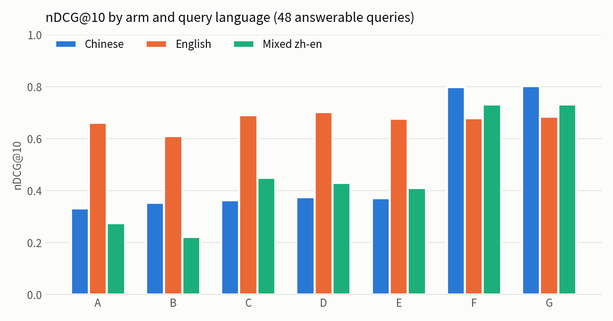

| Arm | Method | nDCG@10 | P@5 | Chinese | English | Mixed |
|---|---|---|---|---|---|---|
| A | BM25 | 0.423 | 0.358 | 0.332 | 0.661 | 0.275 |
| B | + e5 vectors (RRF) | 0.395 | 0.325 | 0.354 | 0.609 | 0.222 |
| C | + Qwen3 rerank | 0.501 | 0.400 | 0.364 | 0.690 | 0.449 |
| D | + constraint penalties | 0.502 | 0.433 | 0.375 | 0.703 | 0.429 |
| E | + freshness / source / completeness / scam priors | 0.486 | 0.413 | 0.372 | 0.677 | 0.410 |
| **F** | **+ Haiku query rewrite** | **0.736** | **0.608** | **0.797** | 0.679 | **0.732** |
| G | + stored LLM posting judgments (hand-set weights) | 0.739 | 0.604 | 0.802 | 0.684 | 0.732 |

| Comparison | Mean diff | W / T / L | p |
|---|---|---|---|
| B vs A | −0.028 | 28 / 0 / 20 | 0.36 |
| C vs A | +0.078 | 33 / 0 / 15 | 0.008 |
| D vs C | +0.002 | 14 / 25 / 9 | 0.87 |
| E vs D | −0.016 | 20 / 3 / 25 | 0.32 |
| **F vs E** | **+0.250** | 35 / 4 / 9 | **< 0.0001** |
| G vs F | +0.003 | 21 / 7 / 20 | 0.79 |

**Reordering the labeled pool (leave-one-query-out).** Gradient boosting over all features reached 0.789, against
0.732 for the reranker score alone (+0.058, p = 0.010) and 0.738 for the hand-set formula (+0.052, p = 0.011). Inside
the learned model, removing the LLM posting-judgment features cost 0.015 (p = 0.053).

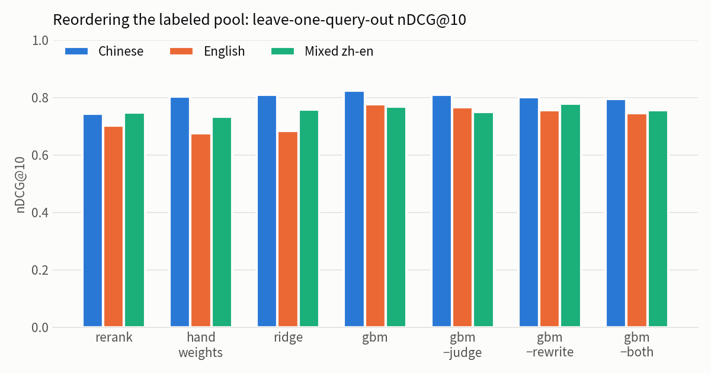

**LLM posting judge.** Claude Haiku judged 1,345 postings ($0.35). Against the labelers on "not an opportunity" it had
73% precision and 93% recall. ATS and job boards had 0% judged not-an-opportunity, V2EX 15%, and GitHub 36% (a batch
of near-duplicate "Bounty" issues).

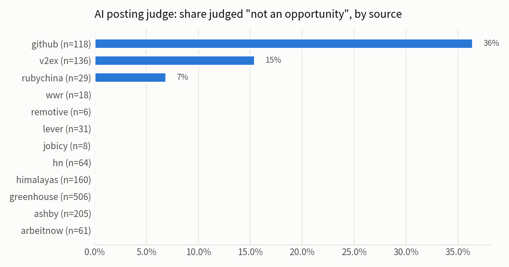

### v1: 48 held-out queries (grok-4.7), same corpus, 5 arms

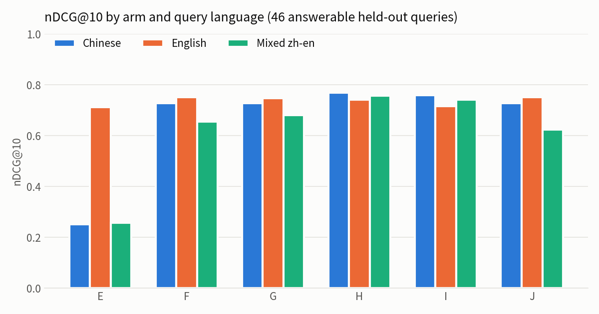

| Arm | nDCG@10 | P@5 | Chinese | English | Mixed |
|---|---|---|---|---|---|
| E (no AI) | 0.413 | 0.087 | 0.251 | 0.712 | 0.257 |
| F | 0.712 | 0.196 | 0.728 | 0.752 | 0.654 |
| G | 0.720 | 0.196 | 0.728 | 0.748 | 0.681 |
| **H** (F's candidates + v0 learned model) | **0.755** | 0.183 | **0.768** | 0.741 | **0.758** |
| I (H without LLM judgments) | 0.738 | 0.183 | 0.758 | 0.716 | 0.742 |

| Comparison (46 answerable queries) | Mean diff | W / T / L | p |
|---|---|---|---|
| **H vs F (primary)** | +0.043 | 29 / 0 / 17 | **0.076** |
| I vs F | +0.026 | 26 / 0 / 20 | 0.30 |
| H vs I | +0.017 | 25 / 2 / 19 | 0.095 |
| G vs F | +0.007 | 20 / 13 / 13 | 0.66 |
| F vs E | +0.299 | 34 / 7 / 5 | < 0.0001 |

- The query-rewrite gain replicated on new queries: Chinese +0.48, mixed +0.40, English +0.04 (n.s.).
- **The primary test missed significance.** After the pay relabel below it became +0.051, p = 0.043, on 44 queries.
- Learned weights mostly did not transfer. The v0-fitted model reordering the v1 pool tied the reranker score alone
  (−0.004), and the hand-set formula was 0.044 *below* it.

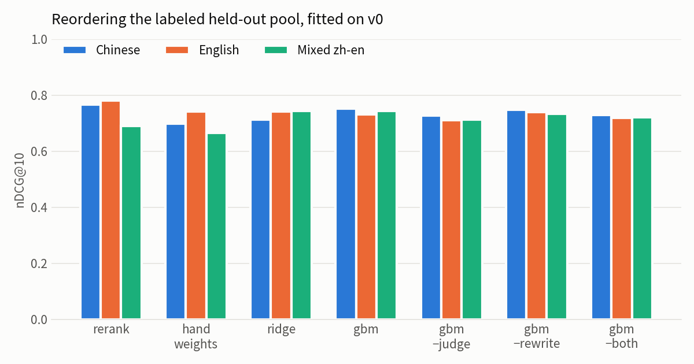

- **Coverage was the larger problem.** Most v1 queries asked for non-software roles. Only 23 of 48 had any good
  posting in the pool, and P@5 fell from 0.61 (v0) to 0.20.

### Source expansion (between v1 and v2)

New feeds and wider queries were added: Himalayas title search, Jobicy full feed, more WWR categories, 22 non-tech Greenhouse
employers, SmartRecruiters, Taiwan Jobs, ncss.cn and more GitHub bounty queries. Postings went from 12,769 to 24,954.
On the *same* v1 queries, F's coverage rose from 22 to 34 of 48 (+13 / −1, p = 0.002) and P@5 from 0.19 to 0.40. That
measurement is in-sample, because the new search terms were chosen after seeing which v1 queries failed.

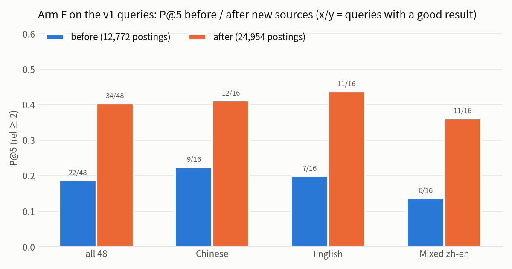

### v2: 48 held-out queries (GPT), new corpus plus old-corpus control

**Primary 1, coverage (arm F, 48 queries): 8 → 15 queries with a good result** (+7 / −0, exact McNemar p = 0.016).
P@5 went from 0.075 to 0.142 (p = 0.004). The gain held on unseen queries, but the absolute level stayed low: Chinese
queries 3/16. Of 62 good results, 50 came from Himalayas.

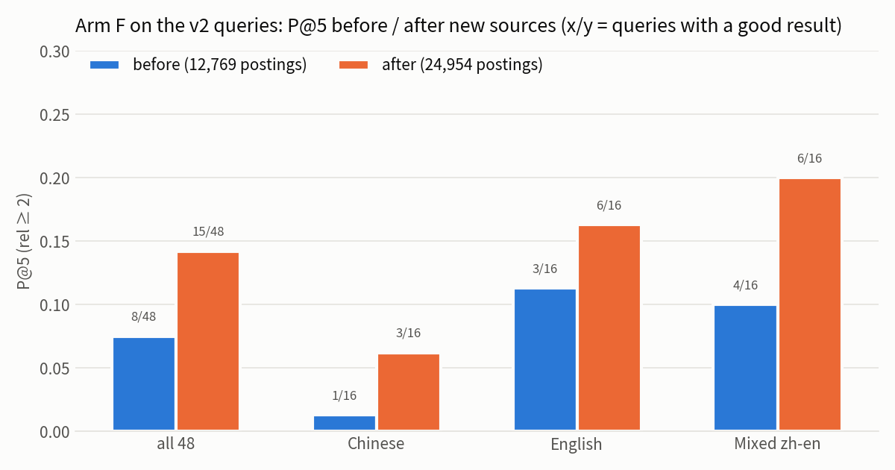

**Primary 2, ordering (44 answerable queries):**

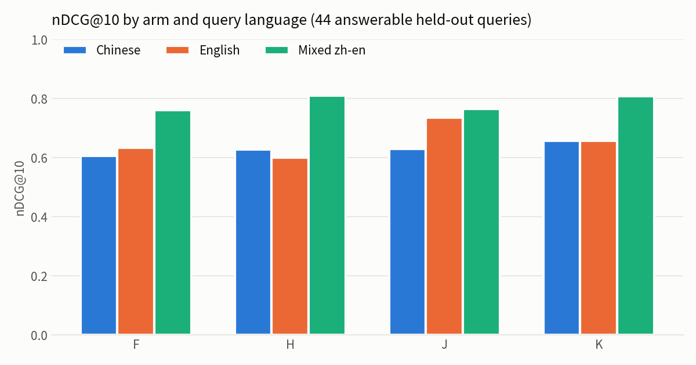

| Arm | nDCG@10 | P@5 | Chinese | English | Mixed |
|---|---|---|---|---|---|
| F | 0.665 | 0.155 | 0.606 | 0.634 | 0.762 |
| H (v0 model) | 0.677 | 0.155 | 0.628 | 0.601 | 0.811 |
| **J** (reranker only) | **0.735** | 0.159 | **0.669** | **0.735** | 0.807 |
| K (model refit on 96 queries) | 0.706 | 0.164 | 0.658 | 0.657 | 0.809 |

| Comparison | Mean diff | W / T / L | p |
|---|---|---|---|
| **H vs F (primary)** | +0.012 | 22 / 0 / 22 | **0.68, not confirmed** |
| J vs F | +0.070 | 30 / 5 / 9 | 0.010 |
| K vs F | +0.041 | 24 / 1 / 19 | 0.074 |
| H vs J | −0.058 | 14 / 0 / 30 | 0.058 |
| K vs J | −0.030 | 14 / 1 / 29 | 0.091 |

J lost most on co-founder queries, where F's kind penalty helped. That pointed to an ablation of each hand-set term.

<a id="pay-relabel"></a>
#### Pay relabel (10-29, a data fix after results)

The redaction rule had masked dates and pay ranges as phone numbers, so labelers in v0–v2 never saw pay. About 17
queries stated a pay requirement (~380 pairs). Those pairs could not get grade 3 for meeting pay, or grade 0 for
failing it. The rule was fixed (`tests/test_text.py`). Every pair of every pay query was then relabeled with the fixed
card: 581 pairs, same labelers as the original round. The list of queries to relabel was set by rule before any new
label existed. Original labels are kept as `eval/labels_*_prepay.jsonl`.

| v2 comparison | Before | After |
|---|---|---|
| Coverage, F | 8 → 15, p = 0.016 | unchanged |
| H vs F | +0.012, p = 0.68 | +0.001, p = 0.98 |
| J vs F | +0.070, p = 0.010 | +0.064, p = 0.018 |
| H vs J | −0.058, p = 0.058 | −0.064, p = 0.042 |
| v1 primary, H vs F | +0.043, p = 0.076 | +0.051, p = 0.043 |

Limit: relabeling also redraws the labelers' random error, with no control, so "seeing pay" and "a second labeling"
cannot be separated.

#### Traditional → Simplified folding (10-30)

Taiwan Jobs postings are in Traditional Chinese, and simplified queries barely matched them. Folding with OpenCC
before tokenizing raised their appearances in BM25 top-100 lists from 811 to 2,546 (96 queries). J changed by
+0.006 (p = 0.30). It was kept as harmless and needed for future Taiwan/Hong Kong sources. The 40 newly surfaced
pairs were labeled. On the same index, J vs F was then +0.065 (p = 0.013) and J vs K +0.039 (p = 0.044).

### Hand-weight ablation (exploratory)

Each hand-set term of F was added alone to the reranker score and evaluated by reordering the existing labeled pools.
These are not pre-registered tests.

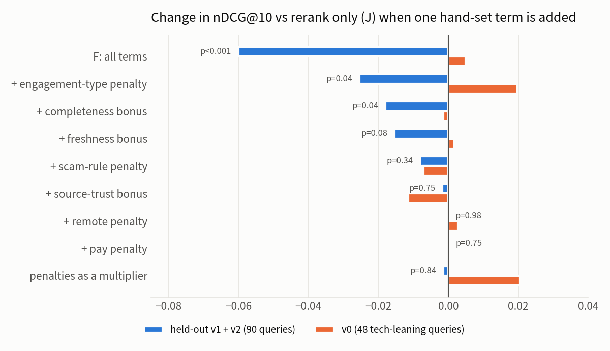

| Ordering vs reranker only (J) | v0 (48) | v1 (46) | v1b (48) | v2 (44) | **v1 + v2 (90)** |
|---|---|---|---|---|---|
| J, nDCG@10 | 0.732 | 0.753 | 0.775 | 0.735 | **0.744** |
| F: all hand terms | +0.005 | −0.050 | −0.025 | −0.071 | **−0.060 (p < 0.001)** |
| + kind penalty | +0.020 | −0.027 | −0.015 | −0.024 | −0.025 (p = 0.042) |
| + completeness bonus | −0.002 | −0.013 | +0.000 | −0.023 | −0.018 (p = 0.038) |
| + freshness bonus | +0.002 | −0.006 | −0.018 | −0.025 | −0.015 (p = 0.081) |
| + scam-rule penalty | −0.007 | −0.009 | −0.002 | −0.007 | −0.008 (p = 0.34) |
| + source-trust bonus | −0.011 | +0.007 | +0.001 | −0.011 | −0.002 (p = 0.75) |
| + remote penalty | +0.002 | −0.001 | 0 | +0.001 | 0 (fires on 14 of 1,821 pairs) |
| + pay penalty | 0 | 0 | 0 | 0 | 0 (fires on 3 pairs) |
| multiplicative penalty (added after seeing the above) | +0.021 | −0.001 | −0.003 | −0.002 | −0.001 (p = 0.84) |

- **Cause: scale mismatch.** Median reranker score per pool was 0.72 for v0 (tech queries) but 0.04–0.07 for v1/v2
  (mostly non-tech). With most candidates near 0, fixed offsets of +0.10 / +0.05 / −0.5 decided ranks 2–10.
- **The kind penalty pushed useful near-misses down.** Except for co-founder queries, postings of the "wrong" kind
  had a *higher* mean grade than the "right" kind. A full-time job in the right role (grade 1) beat a part-time job in
  the wrong role (grade 0).
- After the pay relabel: all terms −0.055 (p < 0.001), same directions.
- Running J end to end on v1 and v1b (170 newly labeled pairs) gave a pooled v1 + v2 J vs F of +0.061 (p < 0.001).
  On v1b alone J and F tied (+0.005), so the J advantage is smaller than v2 alone suggested.
- Action taken: J became the default, constraints became `mismatch` tags, and v3 named J vs the multiplicative
  penalty M as its primary test.

### v3: 48 held-out queries (GPT), plan written before the queries existed

Setup: snapshot v3 (26,095 postings) and v3o (24,954, before an extra ncss city-level crawl and two GitHub bot
queries). Frozen: query rules, rewrite prompt, hand weights, reranker, vectors, fetchers. L was trained before the v3
queries were written. Labels: composer-2.5 + grok-4.7, no GPT. 756 pairs on v3; 480 on v3o, of which 425 were
reused.

| Arm | nDCG@10 | Chinese | English | Mixed | P@5 | MRR | top-10 share grade ≥ 1 | queries with a good result |
|---|---|---|---|---|---|---|---|---|
| F | 0.654 | 0.557 | 0.749 | 0.655 | 0.167 | 0.230 | 0.445 | 15 |
| **J** | **0.785** | 0.758 | 0.778 | 0.820 | 0.152 | 0.205 | 0.548 | 15 |
| L | 0.782 | 0.786 | 0.774 | 0.787 | 0.181 | 0.232 | 0.569 | 15 |
| M | 0.782 | 0.746 | 0.814 | 0.787 | 0.167 | 0.236 | 0.536 | 15 |

| Primary test | Result | p | Holm p | Verdict |
|---|---|---|---|---|
| J vs M, nDCG@10 | +0.003, 14 / 15 / 13 | 0.85 | 1.00 | no evidence of a difference |
| J vs F, nDCG@10 | +0.132, 29 / 0 / 13 | 0.0003 | **0.0009** | J better |
| ncss city crawl, J coverage (42 non-buyer queries) | 15/42 → 15/42 | 1.00 | 1.00 | no help |

| Secondary | nDCG diff (p) | P@5 diff (p) | MRR diff (p) |
|---|---|---|---|
| L vs J | −0.003 (0.90) | +0.029 (0.11) | +0.026 (0.34) |
| L vs F | +0.129 (0.0005) | +0.014 (0.53) | +0.002 (0.88) |
| J vs F | — | −0.014 (0.62) | −0.025 (0.29) |
| M vs J | — | +0.014 (0.25) | +0.030 (0.06) |

**The 48 queries are not independent.** GPT largely wrote the same 16 needs in three languages. Testing by theme
instead (16 themes, exact sign-flip) gives J vs F p = 0.005 (Holm 0.016). The conclusion holds.

**Where J wins (exploratory, split after seeing results):**

| Queries | n | F | J | L | M | J − F | M − J |
|---|---|---|---|---|---|---|---|
| Pool has a grade ≥ 2 posting | 15 | 0.808 | 0.791 | 0.842 | 0.830 | −0.017 (p = 0.56) | +0.040 (p = 0.005) |
| Best in pool < 2 | 27 | 0.568 | 0.783 | 0.749 | 0.755 | +0.215 (p = 0.0001) | −0.027 (p = 0.23) |

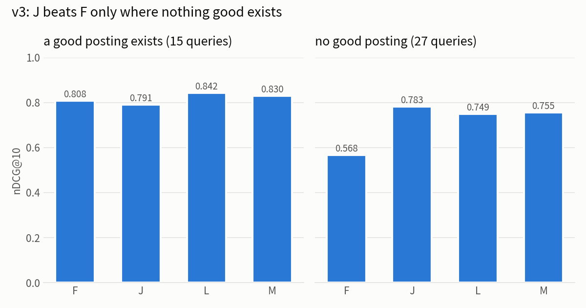

J's gain comes from ordering *weak* matches better when no good posting exists. nDCG normalizes per query, so a query
whose best posting is grade 1 weighs as much as one with a grade-3 posting. J does not show users more good jobs:
P@5 and MRR do not improve. M's edge on the 15 queries with a good posting is a hypothesis for a future round, not a
result.

**ncss city crawl.** The top 10 changed for 23 queries, and 54 new postings entered (52 from ncss). None of the
postings swapped in or out had grade ≥ 2. Coverage and P@5 were identical. The data was kept, and no more crawls of
that kind were made.

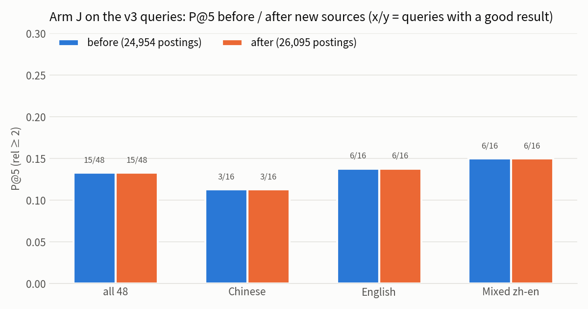

**Before making L the default (exploratory checks on the v3 labels):**

| Training queries | 24 | 48 | 72 | 96 | 120 | 144 |
|---|---|---|---|---|---|---|
| nDCG@10, mean of 20 random subsets | 0.749 | 0.762 | 0.771 | 0.775 | 0.778 | 0.782 |

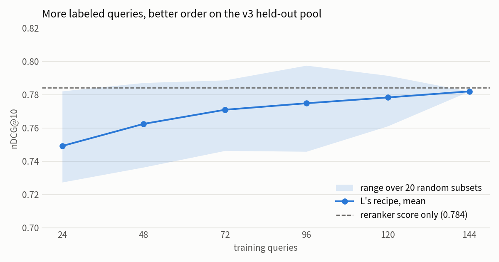

- The reranker score alone gives 0.784, so L only catches up at 144 queries. Each extra 24 queries now adds ~0.004.
- Simulated ageing of every posting by 30 / 90 / 180 days: nDCG 0.786 / 0.780 / 0.784, with 96–97% top-10 overlap.
  The freshness feature barely matters.
- Permutation importance: `rerank` 0.171, `rerank_en` 0.111, `dense_en` 0.013, `viol` 0.010, `dense` 0.003, the other
  6 ≈ 0.
- L calls the reranker twice, so it takes about 2× J's time (median 15.7 s vs 8.5 s on a shared GPU). Repeated runs
  of the same query vary slightly: reranker scores differ by ~0.002 between calls, and tree scores are piecewise. 1 of
  4 queries changed order between two runs.

<a id="coverage-gaps"></a>
## 3. Coverage gaps

Over the 96 held-out queries of v1 + v2 (descriptive), 53 had a good posting in the pool. This count includes J's
extra v1 labels; it was 52 before them. The split follows query type more than language:

| Query type (rules applied in order) | Queries | With a good result |
|---|---|---|
| Co-founder | 6 | 1 |
| Open-source bounty | 6 | 2 |
| Local job (names a place, not remote) | 32 | 10 |
| Outsourcing project | 12 | 5 (the 7 misses are all buyers looking for a provider) |
| Remote job and other | 40 | 35 |

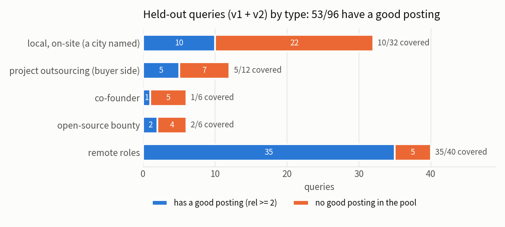

- **Local jobs lack postings, not ranking.** 16 of the 22 failed local queries named cities with 0–31 postings in the
  corpus. The others named cities whose postings were almost all tech-company ATS roles.
- **Buyer-side outsourcing** ("outsource an onboarding video series") wants providers, not job posts. Every
  outsourcing platform reviewed forbids automated access. Since 11-01, `eval/gaps.py: buyer_side` reports these
  queries separately, and coverage tests exclude them.
- v3 confirmed the pattern on clean queries: 15/48 covered, all remote; every other kind of query 0/30.

<a id="mismatch-tags"></a>
## 4. `mismatch` tags against existing labels

`python eval/mismatch_tags.py`: all 192 queries, 5,319 labeled pairs. The tags were added after labeling, so this
measures agreement with the labelers, not user benefit.

| Tag | Pairs where the query states it | Tagged | Mean grade tagged / untagged | Good results wrongly tagged |
|---|---|---|---|---|
| remote | 2,105 | 84 | 0.96 / 1.07 | 17 / 545 (3%) |
| pay | 675 | 54 | 0.18 / 0.96 | 0 / 145 |
| place | 1,667 | 900 | 0.28 / 0.52 | 3 / 64 (5%) |
| on-site | 90 | 36 | 0.19 / 0.20 | no good results to compare |
| type | 4,630 | 1,647 | 0.75 / 0.74 | 97 / 576 (17%) |

The type tag is unreliable. Until 11-07 the labeling card did not show the source's stated job type, so labelers
guessed it from the text, and the system's own kind defaults to full-time when nothing is stated. Cards now carry a
"Type" line when the source states one. The 17 remote-tag errors are all Ashby hybrid postings (next section).

## 5. Labeler calibration: Claude Haiku + GPT-6-Luna (11-06)

The original labelers became unavailable. Before any new round, two replacement labelers graded 200 v1 pairs: all 48
with an old mean ≥ 2, plus 152 at random, reweighted to v1's mix. Neither replacement had written the v1 queries.

| Comparison (weighted to v1) | Weighted kappa | Within 1 | Same good / not-good call |
|---|---|---|---|
| Old pair: composer vs grok | 0.64 | 97% | 86% |
| New pair: Haiku vs Luna | 0.60 | 98% | 90% |
| **New mean vs old mean** | **0.76** | 99% | **97%** |

- **The new pair can take over.** GPT-6-Luna grades weak results about +0.18 higher, so nDCG levels from a new round
  are not comparable to old rounds. Comparisons within a round are unaffected.
- Haiku also writes the query rewrites. On the 112 pairs found only by rewrite arms, it graded 0.03 *below* the old
  labelers, so no self-preference was found.
- Copy check: labelers ran in isolated folders with no tools. Identical answers to the old labelers occurred in
  1/200 pairs.
- **Open data issue.** Ashby marks hybrid jobs `isRemote`, and before the 11-06 fix the cards said "remote" for 135
  labeled Ashby pairs (47 graded ≥ 2). Those labels are in L's training data and in the v1–v3 scores. Relabeling them
  would change published numbers, so it has not been done. The effect on v3 L nDCG@10 from the field fix itself was
  nil (0.782): 1 v3 pair changed its `viol` feature.

## 6. Costs

| Round | Haiku query rewrites | Haiku posting judgments | Labels |
|---|---|---|---|
| v0 | ~$0.05 (48) | $0.35 (1,345) | 1,311 pairs; GPT review 179 |
| v1 | $0.05 (48) | $0.24 (948) | 968 pairs; GPT review 308 |
| source expansion | — | $0.31 (1,240) | 486 new pairs |
| v2 | ~$0.05 (48) | ~$0.33 (1,326) | 1,262 new pairs |
| v3 | ~$0.016 (49) | none | 811 new pairs |
| calibration | — | $0.105 (200 Haiku labels) | — |

## 7. Limits that apply to every round

1. All labels are LLM labels. No human audit has been done.
2. The synthetic queries over-represent non-software roles and type constraints, so they are not real traffic.
3. 42–48 queries cannot show small differences. A tie means no evidence of a difference.
4. All arms in a round share F's top-50 candidates, so a good posting below rank 50 is invisible.
5. Old-corpus controls (v2o, v3o) use today's index with an id cut-off, so BM25 statistics include later postings.
6. Saved runs are authoritative. Re-running an arm today gives slightly different results: later ingests updated some
   posting text, and reranker scores jitter.

## 8. Reproduce

From the stored files (no database or services). `paired.py` also writes `eval/paired_<set>.json`.

```bash
# v3 (no relabel happened after v3, so the current labels are the reported ones)
python eval/score.py v3
python eval/paired.py v3 M:J F:J J:L F:L

# v0-v2 tables as first reported: labels before the 10-29 pay relabel, v2's J run before the 10-30 folding
RANKAI_LABEL_SET=prepay python eval/score.py v0
RANKAI_LABEL_SET=prepay python eval/paired.py v0 A:B A:C C:D D:E E:F F:G
RANKAI_LABEL_SET=prepay python eval/score.py v1
RANKAI_LABEL_SET=prepay python eval/paired.py v1 F:H F:I I:H F:G E:F
RANKAI_LABEL_SET=prepay python eval/score.py v2
RANKAI_LABEL_SET=prepay python eval/paired.py v2 F:H F:K H:K F:J_pre_t2s H:J_pre_t2s K:J_pre_t2s

# the same with the current labels (after the pay relabel and the later J labels)
python eval/score.py v2 && python eval/paired.py v2 F:H F:K H:K F:J H:J K:J

python eval/ltr.py --fit v0 v1 v1b v2 v2o v1c v2c   # rebuilds L's model exactly from eval/features_*.jsonl
```

- `labels_<set>.jsonl` holds the current labels. `labels_<set>_prepay.jsonl` holds the labels before the pay
  relabel. In the prepay files, v1's and v2's J rows show unlabeled results: J's extra pairs were labeled after the
  relabel.
- The arm tables match the reported numbers exactly. p-values come from a seeded Monte Carlo test, and the random
  stream depends on which pairs are listed and in what order. Listing pairs differently can move a p-value by about
  0.01 (e.g. v0 G vs F: 0.79 reported, 0.78 in another order).
- `eval/report_v3.py`, `eval/coverage.py`, `eval/gaps.py`, `eval/model_checks.py` and `eval/charts.py` also read the
  database (snapshot sizes, posting fields, query rewrites), and `eval/pool.py` runs live arms. Those need a local
  corpus and the model services.

Full pipeline for a new round on your own corpus:

```bash
python -m rankai snapshot v4                          # freeze the corpus
python eval/pool.py v4 FJLM                           # run arms, save runs, write labeling tasks
RANKAI_LABELER=<your dual-labeling command> bash eval/run_labels.sh v4
python eval/merge_labels.py v4 && python eval/score.py v4 && python eval/paired.py v4 F:J J:L
```
